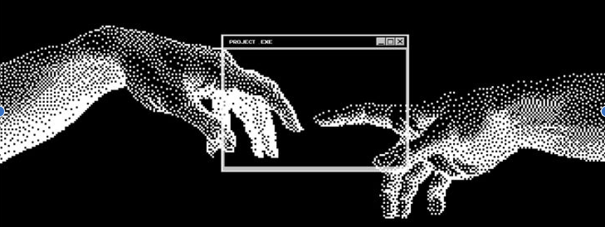

# Hi, I'm Ayushi 👋

  
  
  

## `$ whoami`

I'm a **B.Tech Computer Science** student specializing in **AI & ML** at **VIT Bhopal** (class of 2027). I like the whole pipeline — framing the problem, training and validating the model, and shipping the interface that makes it useful.

My work lives where **applied ML meets real people**: a physiotherapy coach that watches your form, a financial agent that reasons across documents *and* databases, a legal assistant for rural India, and an anomaly detector that explains itself. I optimize for numbers I can defend — precision, latency, accuracy — not just demos.

| | |
|:---|:---|
| 🎓 **Education** | B.Tech CSE (AI & ML) · VIT Bhopal · 2027 |
| 📍 **Based in** | Bengaluru, India |
| 🔭 **Building** | [IntentFlow](https://github.com/ayushikashyap1207/IntentFlow) · [LedgerMind](https://github.com/ayushikashyap1207/ledgermind) |
| 🧠 **Ask me about** | RAG & agentic AI · anomaly detection · OCR · shipping ML |
| 🎨 **Off the clock** | Painting & sketching |
| 🎯 **Open to** | AI/ML internships, collaborations, interesting problems |

## 🛠️ Tech stack

**Languages & web**

**Data & infrastructure**

**AI / ML & data**

## 🚀 Featured projects

### 🏥 [IntentFlow](https://github.com/ayushikashyap1207/IntentFlow) · Clinical rehabilitation AI

A physiotherapy coach that watches your exercise form in real time and talks you through it.

`Next.js` `FastAPI` `TFLite LSTM` `MediaPipe` `Groq` `Supabase`

- Real-time pose estimation and LSTM-based exercise classification, running locally via TFLite
- Groq-powered coaching chat, plus clinical session logging and patient progress tracking

### 💼 [LedgerMind](https://github.com/ayushikashyap1207/ledgermind) · Enterprise financial AI agent

Ask a finance question that spans a 10-K *and* the ledger — get one grounded answer, with citations.

`Python` `FastAPI` `LangGraph` `Llama 3.1` `PostgreSQL` `ChromaDB` `LangSmith`

- A router sends each question to RAG, safe Text-to-SQL, or both, then synthesizes a single answer
- Every claim traces back to a document chunk or SQL result, with an eval harness built in

### ⚖️ [Nyaya Mitra v2](https://github.com/ayushikashyap1207/Nyaya-Mitra-v2) · AI legal assistant for rural India

Upload a court summons, FIR, or rental agreement — get a plain-language summary you can actually act on.

`Python` `Gradio` `LLaMA 3.1` `PyMuPDF` `Tesseract` `EasyOCR` `gTTS`

- Extracts key dates, urgency, legal rights, consequences, and next steps from PDFs or phone photos
- OCR fallback chain (Tesseract → macOS Vision → EasyOCR) with audio summaries in Hindi, Marathi, Tamil & Telugu

### 🛡️ [Behavioral Anomaly Detection](https://github.com/ayushikashyap1207/honeywell2) · Cybersecurity

A dual-detector engine that learns what "normal" looks like for users, service accounts, and edge devices.

`Python` `PyTorch` `scikit-learn` `FastAPI` `Kafka` `Redis` `PostgreSQL` `React`

- Isolation Forest for cold-start entities + LSTM autoencoder over session windows, fused by percentile rank
- **89% precision @ top-1% alert budget** · 18,600+ sessions scored · plain-language alert explanations

## 🧩 More projects

| Project | What it does | Built with |
|:---|:---|:---|
| ⭐ **[NYAYA-MITRA](https://github.com/ayushikashyap1207/NYAYA-MITRA)** | The first Nyaya Mitra — free legal-document simplifier for rural India, with OCR, translation & audio | React · Node.js · OCR · NLP |
| 🎤 **[PresentIQ](https://github.com/ayushikashyap1207/presentIQ)** | RAG-powered presentation coach: extracts 8 speech & vision metrics, retrieves coaching knowledge, writes grounded feedback | TypeScript · Python · ChromaDB · GPT-4o-mini |
| 🕳️ **[Pothole Detector](https://github.com/ayushikashyap1207/pothole-detector)** | GPU-free road-damage detector using classical OpenCV; outputs annotated media + JSON/text reports | Python · OpenCV |
| 🌾 **[Crop Recommendation](https://github.com/ayushikashyap1207/crop-recommendation-system)** | 3-tier app that pulls live soil & weather data from coordinates and recommends the best crop (~90% accuracy) | Flask · Node.js · MongoDB · scikit-learn |
| 📚 **[Book Recommender](https://github.com/ayushikashyap1207/book_recommend_system)** | Flask collaborative-filtering app with popularity rankings and "similar books" | Python · Flask · Pandas |
| 🛒 **[Book Store Management](https://github.com/ayushikashyap1207/book-store-management)** | Bookstore app for browsing stock and placing orders with an account system | Python · MySQL |
| 🎪 **[EventHub / FES-NECT](https://github.com/ayushikashyap1207/FES-NECT)** | Event discovery front end for finding things to do across India | HTML · CSS · JavaScript |
| ☕ **[JAVA](https://github.com/ayushikashyap1207/JAVA)** | Java problem-solving repo I use to keep DSA sharp | Java |
| 🌐 **[Portfolio](https://github.com/ayushikashyap1207/ayushi-portfolio)** | The site that ties it all together | React · Vite |

## 🏆 Highlights

- 🎯 **145+ LeetCode** problems solved · completed the **100-Day Coding Challenge** (#DrGViswanathan)
- ⭐ **5 stars** on NYAYA-MITRA — my first legal-tech project, now evolved into Nyaya Mitra v2
- 📜 **Applied Machine Learning in Python** — University of Michigan · Dec 2025
- 🦈 **Pull Shark** — GitHub achievement

## 📊 GitHub, by the numbers

---

### 💬 Let's build something meaningful

I'm open to **AI/ML internships**, research collaborations, and teams shipping real products.

Bengaluru, India · currently deep in RAG, agents, and evaluation

